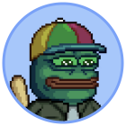
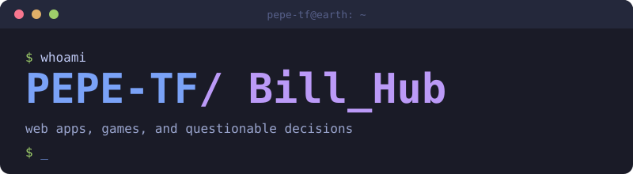
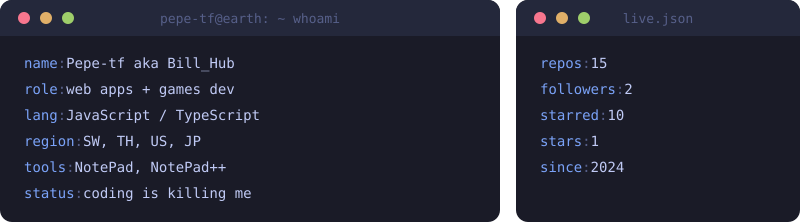
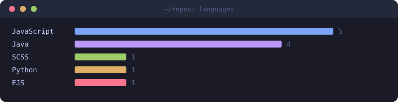

**a developer from somewhere on earth** ✨

<a href="#-plugins">plugins</a> · <a href="#-stack">stack</a> · <a href="#-languages">languages</a> · <a href="#-stats">stats</a> · <a href="#-find-me">find me</a>

## 🔌 Plugins

### FakePlayerPlugin 2.0

The rewrite nobody asked for but everybody needed. Same idea as Origin, planned this time instead of improvised. Better pathing, better performance, doesn't fall over if two fake players exist at once.

<code>npc</code> <code>testing</code> <code>paper</code> <code>purpur</code> <code>folia</code>
 

<table><tr>
<td width="33%"> PvE mob farms</td>
<td width="33%"> Find and mine</td>
<td width="33%"> Bot rental</td>
</tr></table>

 

---

### FakePlayerPlugin Origin

The original fake-player spawner. Built in a weekend, held together by hope and a few try/catch blocks we're not proud of. Still running because nobody wants to be the one who breaks it.

<code>npc</code> <code>testing</code> <code>pvp</code> <code>pathfinding</code>

<table><tr>
<td width="33%"> Pathfinding</td>
<td width="33%"> Group PvP</td>
<td width="33%"> Difficulty tiers</td>
</tr></table>

---

### Scripted SMP Core

The plugin nobody sees but everything depends on. The backbone of our SMP server: teams, nicknames, proximity chat, death tracking, recording mode and admin tools in one place.

<code>core</code> <code>smp</code> <code>utility</code>
 

<table><tr>
<td width="33%"> Teams</td>
<td width="33%"> Proximity chat</td>
<td width="33%"> Recording mode</td>
</tr></table>

 

## 🛠 Stack

## 📊 Languages

## 📈 Stats

 

## 🔗 Find me

<!-- Last updated on Fri Oct 23 2026 09:09:45 GMT+0200 (Central European Summer Time) ;-;-->
last updated 23rd October 2026 using magic

